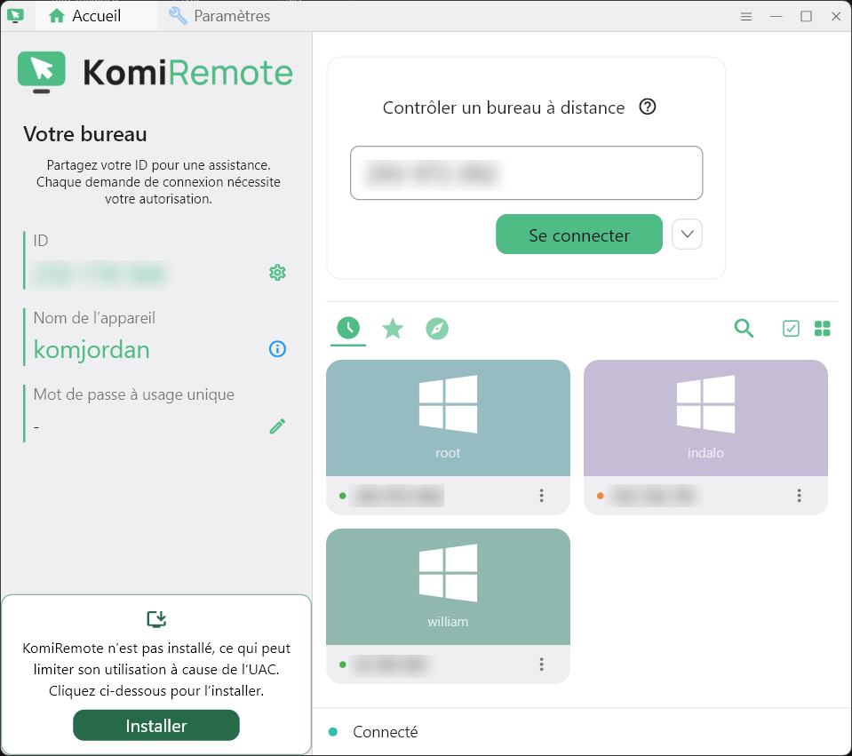
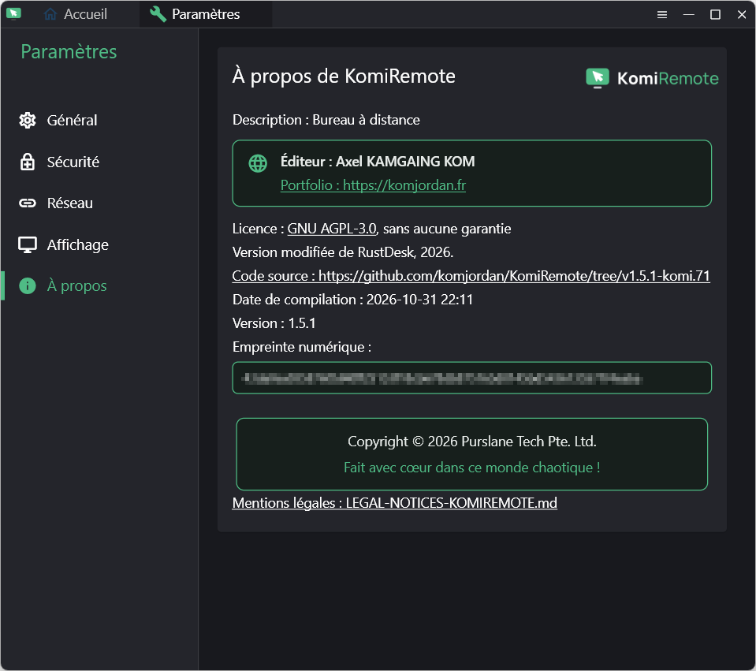
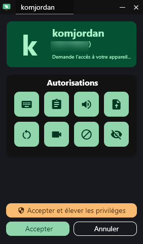
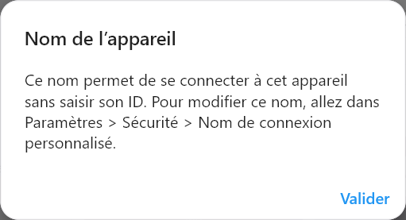
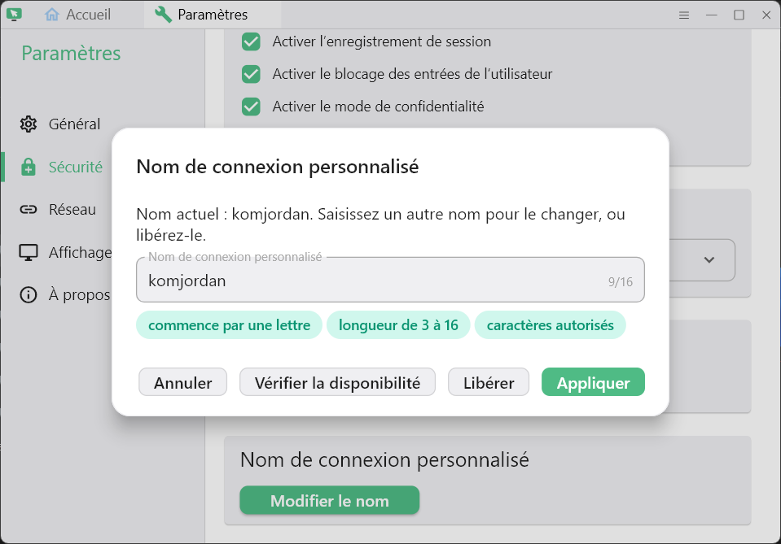

<p align="center">
  <picture>
    <source media="(prefers-color-scheme: dark)" srcset="flutter/assets/logo_dark.png">
    
  </picture>
</p>

<p align="center">
  <b>KomiRemote</b> — bureau à distance pour Windows, version modifiée de RustDesk.<br>
  <a href="https://komjordan.fr/komi.html">Télécharger</a> ·
  <a href="docs/komiremote/LEGAL-NOTICES-KOMIREMOTE.md">Mentions légales</a> ·
  <a href="LICENCE">AGPL-3.0</a>
</p>

<p align="center">
  <strong>Version actuelle&nbsp;: <a href="https://github.com/komjordan/KomiRemote/tree/v1.5.1-komi.71">v1.5.1-komi.71</a></strong>
  <br>
  <sub>Windows portable · première build publiée</sub>
</p>

> [!IMPORTANT]
> **KomiRemote est une version modifiée de [RustDesk](https://github.com/rustdesk/rustdesk), distribuée sous licence GNU AGPL-3.0.**
> Ce projet n’est **ni affilié à, ni approuvé, ni soutenu** par RustDesk ou Purslane Tech Pte. Ltd.
> « RustDesk » est cité uniquement pour indiquer l’origine du code.

> [!CAUTION]
> **Usage responsable :** n’utilisez KomiRemote que sur des appareils pour lesquels vous avez une autorisation explicite.
> Tout accès non autorisé, prise de contrôle ou atteinte à la vie privée est interdit. Les auteurs ne sont pas responsables d’une utilisation abusive.

## Présentation

KomiRemote reprend le moteur de bureau à distance de RustDesk OSS (base 1.5.0) et y ajoute une interface simplifiée en français pour un usage personnel sous Windows :

- identité visuelle KomiRemote (icônes, logos, nom d’application `KomiRemote` séparé de RustDesk) ;
- interface épurée : barre de session repliable, disponible en mode minimal ou complet, textes et menus revus en français ;
- approbation manuelle des connexions entrantes par défaut ;
- enregistrement de session avec dialogue « enregistrement sauvegardé » ;
- nom de connexion personnalisé : un appareil peut être joint par son nom en complément de son ID numérique ;
- page À propos avec licence, code source et mentions légales ;
- notification de mise à jour basée sur `https://komjordan.fr/komi-version.json` (aucun téléchargement automatique) ;
- les fonctions présentées (connexion, nom personnalisé, approbation, enregistrement et barre de session) s’utilisent sans compte. L’option « rédiger une note en fin de connexion », qui dépend d’un compte, reste masquée.

## Téléchargement

La version portable Windows (`KomiRemote.exe`) est publiée sur **<https://komjordan.fr/komi.html>**, avec sa taille, sa date et son empreinte SHA-256.

Vérifiez l’empreinte avant de lancer l’exécutable :

```powershell
Get-FileHash .\KomiRemote.exe -Algorithm SHA256
```

L’exécutable n’est pas signé : Windows SmartScreen peut afficher un avertissement (« Informations complémentaires » → « Exécuter quand même »).

## Code source correspondant

La version portable publiée correspond au tag [`v1.5.1-komi.71`](https://github.com/komjordan/KomiRemote/tree/v1.5.1-komi.71). La branche `main` contient les évolutions ultérieures.

## Captures

Captures de KomiRemote v1.5.1-komi.71. Les IDs de connexion sont floutés ; les noms d’appareils restent visibles.

### Accueil



### À propos



### Demande de connexion



### Nom de l’appareil

Le nom de l’appareil permet de s’y connecter sans ressaisir son ID. Il se règle dans **Paramètres → Sécurité → Nom de connexion personnalisé**.



### Nom de connexion personnalisé

Le nom choisi complète l’ID numérique et peut être vérifié, appliqué ou libéré depuis les paramètres de sécurité.



### Barre de session

**Mode minimal**

<p align="center">
  
</p>

**Mode complet**

<p align="center">
  
</p>

## Compilation (Windows)

Prérequis : Visual Studio 2022 (outils C++), Rust, Flutter, vcpkg et Python 3, comme pour RustDesk.
Voir la [documentation de compilation RustDesk](https://rustdesk.com/docs/en/dev/build/) et [docs/komiremote/BUILD.md](docs/komiremote/BUILD.md).

```powershell
python build.py --portable --flutter --hwcodec --vram
```

## Licence et copyright

KomiRemote est distribué selon la **GNU Affero General Public License v3.0** — texte intégral dans [`LICENCE`](LICENCE).

- Copyright © Purslane Tech Pte. Ltd. et contributeurs RustDesk (code d’origine : <https://github.com/rustdesk/rustdesk>).
- Modifications KomiRemote © 2026 Axel KAMGAING KOM.

Ce programme est fourni **sans aucune garantie**. Les licences des dépendances tierces restent applicables.
Détails : [mentions légales KomiRemote](docs/komiremote/LEGAL-NOTICES-KOMIREMOTE.md).
